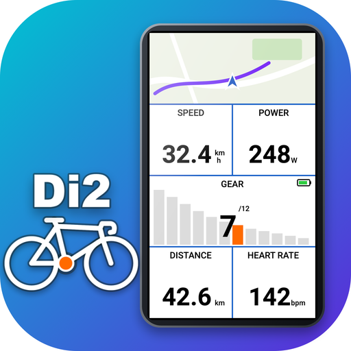
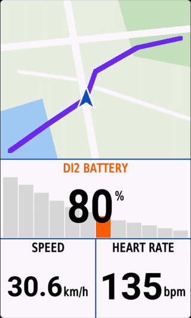
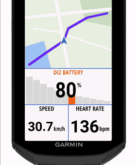
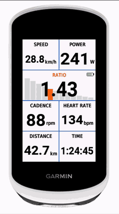
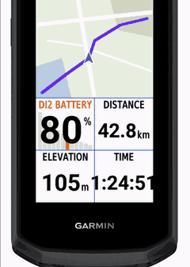
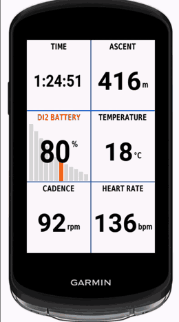
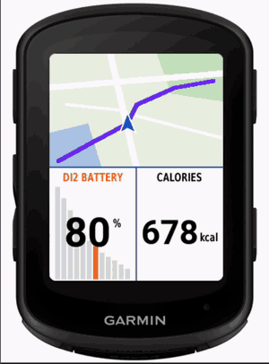

# Edge Di2 Field

Shimano Di2 **gear and battery** on Garmin **Edge** bike computers, including the Edge Explore 2, which has no built-in Di2 support.

A Connect IQ data field that connects to your Di2 rear derailleur over Bluetooth and shows the current gear, cog, gear ratio and Di2 battery. You can switch views with the D-FLY button on your shifter.

<p align="center"></p>

| Edge 1050 | Edge Explore 2 | Edge Explore 3 | Edge 1040 | Edge 840 |
|:---:|:---:|:---:|:---:|:---:|
|  |  |  |  |  |

## Features

- **Gear**: current gear (`6/12`), drawn over your cassette with the active cog highlighted
- **Cog**: rear cog in teeth (`24T`), shown with the chainring and cog drawn to scale
- **Ratio**: chainring / cog (`1.67`)
- **Di2 battery**: level in percent, colour-coded like Shimano's own indicator
- **Battery range**: estimated km left, learned from your own rides
- **Low battery warning**: a tone once per ride when the Di2 battery reaches 10% (adjustable); the field label stays red while the battery is low
- **Short dropouts**: if the connection drops, the last gear stays on screen in grey for 30 s
- **D-FLY button**: short press = next view, long press = previous view, double press = gear
- **Stats in Garmin Connect**: charts for gear, cog and gear ratio; the summary shows % of ride time per gear, average and max ratio, number of shifts and the battery level
- **Two bikes**: separate cassette and chainring settings for bike 1 and bike 2
- **26 languages**: all European languages supported by the Edge, plus Russian and Chinese (Simplified)

## 500 km free trial

Everything works for your first **500 km** (counted while riding with the Di2 connected). The remaining
trial distance is shown briefly at the start of each ride, and permanently during the last 50 km.
After that, the field asks for a one-time license.

**Get a license (one-time):** buy me a coffee on [Ko-fi](https://ko-fi.com/vanderkley). You will get
a license code by e-mail (sent to your Ko-fi / PayPal e-mail address, or the address you put in the
message). Enter that e-mail and the code in the app settings
(Connect IQ app → Di2 Gear and Battery → Settings).

## Compatibility

| | Supported |
|---|---|
| Edge | Explore 2, Explore 3 / 3 Plus, 530, 830, 1030 / 1030 Plus, 540, 840, 1040, 550, 850, 1050, 1060, Edge MTB. Tested on the Explore 2 (firmware 30.22) |
| Di2 | 12-speed wireless Di2 (road, GRX, MTB). Tested on RD-M8250 + ST-RX825 |
| Front derailleur (2x) | Experimental, not yet tested |

> **Got a 2x Di2?** Help verify front derailleur support: create an empty file
> `Garmin/Apps/LOGS/DI2.TXT` on the Edge, ride a few minutes using both chainrings, and
> attach that file to a GitHub issue. The field logs every raw gear packet there.

> **Edge Explore 2 firmware 31.33 is not supported.** It has a Bluetooth bug that blocks
> Connect IQ apps from reading Di2. The field then shows *"Edge firmware not supported"*.
> It works on 30.22. Other Edge models with the same firmware generation may be affected too.

## Install

1. Download `Di2.prg` from [Releases](../../releases), or [build it yourself](#build-from-source).
2. Connect the Edge via USB and copy `Di2.prg` to `Garmin/Apps/`.
   On macOS, use `scripts/install-macos.sh` (see below).
3. Unplug the Edge. Go to **Activity Profiles → profile → Data Screens**, pick a field
   and choose **Connect IQ → Di2 Gear and Battery**.
4. Close the E-TUBE app on your phone, then shift once to wake the Di2.

Cassette, chainring(s), active bike and battery warning are app settings (Connect IQ app on
your phone). Sideloaded apps can't be configured from the phone: put your bike in
`resources-personal/settings/properties.xml` and build with `scripts/build.sh personal`.

## Build from source

Requirements: [Connect IQ SDK](https://developer.garmin.com/connect-iq/sdk/) (with the
*Edge Explore 2* device installed), Java 17, and on macOS `brew install libmtp` for USB install.

```sh
# one-time: create a developer key
openssl genrsa -out developer_key.pem 4096
openssl pkcs8 -topk8 -inform PEM -outform DER -in developer_key.pem -out developer_key.der -nocrypt
export DEVELOPER_KEY=$PWD/developer_key.der

scripts/build.sh            # -> bin/Di2.prg (no bike preset)
scripts/build.sh personal   # -> bin/Di2.prg with your bike from resources-personal/
scripts/build.sh export     # -> bin/Di2.iq store package, all devices
scripts/keygen.py you@example.com   # Pro code for your own build
scripts/install-macos.sh    # copy to the Edge over USB (close Garmin Express first)
scripts/simulate.sh         # demo with fake data in the Connect IQ simulator
scripts/simulate.sh layouts # same, on a full Edge page with several fields
scripts/simulate.sh lowbatt # same page with a low Di2 battery (tone + red label)
DEVICE=edge1040 scripts/build.sh   # build for another Edge model
```

Self-built versions use a public placeholder secret (`source/Di2Secret.mc.example`), so
`scripts/keygen.py` gives you a working Pro code for your own build. Codes for the store version
are not interchangeable with self-built ones.

## How it works

The field talks to the rear derailleur over Bluetooth LE without pairing or a passkey. The protocol notes are in [docs/PROTOCOL.md](docs/PROTOCOL.md).

## Disclaimer

This is an independent project, not affiliated with or endorsed by Shimano or Garmin.
Shimano and Di2 are trademarks of Shimano Inc.; Garmin and Edge are trademarks of Garmin Ltd.
Use at your own risk.

## License

[PolyForm Noncommercial 1.0.0](LICENSE): free to use, study and change for non-commercial purposes.
Selling it or publishing it as your own app is not allowed.
